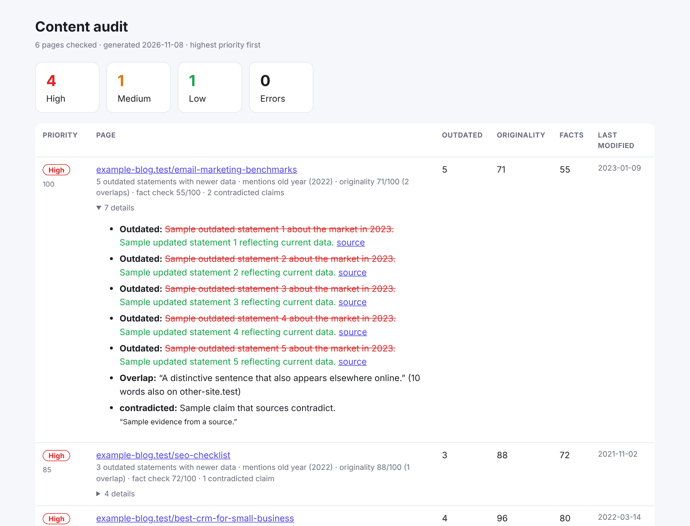

# AI Site Audit

  

Point it at a sitemap and find out **which pages to fix first**. It checks every page for outdated statements, copied text and claims the sources contradict, then ranks them in a report you can open in a browser or drop into a spreadsheet. Powered by your own [RapidTextAI](https://app.rapidtextai.com) API key.



*The screenshot was captured in demo mode with a fake site and sample data (see [Try it without a key](#try-it-without-a-key)).*

## Why use it

- **Know where to start.** Instead of re-reading hundreds of posts, you get one ranked list. The pages that most need attention are at the top, with the reason next to each.
- **Fight content decay.** The refresh check finds statements that now have newer data, with a cited source for each suggested update. `--older-than 365` targets only pages untouched for a year.
- **Catch risk early.** Spot copied passages and claims that live sources contradict before they cost you traffic or trust.
- **Spend only what you mean to.** The cost is estimated up front, and large runs need an explicit `--yes`. Finished pages are never charged twice.
- **Safe to interrupt.** Results are saved after every page. Press Ctrl-C and re-run the same command to pick up where you left off.
- **Fits your workflow.** An HTML report for reading, a CSV for spreadsheets, and `state.json` for scripts. Zero dependencies.

## Requirements

- [Node.js](https://nodejs.org) 18 or newer
- A RapidTextAI account and API key (<https://app.rapidtextai.com>)

## Install

```bash
git clone https://github.com/alisaleem252/ai-site-audit.git
cd ai-site-audit
cp .env.example .env        # then paste your key into .env
```

## Use it

```bash
# Audit the 10 oldest-looking blog posts in a sitemap
node bin/cli.js --sitemap https://example.com/sitemap.xml --include /blog/ --older-than 365

# Audit a list of URLs (.txt or .csv, first column), with fact checking too
node bin/cli.js --urls urls.txt --checks refresh,originality,fact-check --max 25 --yes

# Just a couple of pages
node bin/cli.js https://example.com/post-a https://example.com/post-b
```

Then open `audit-output/report.html`. Each run writes:

| File | Contents |
|---|---|
| `report.html` | Ranked, readable report with expandable details per page |
| `report.csv` | The same ranking for spreadsheets |
| `state.json` | Raw results, used for resuming |

### Options

| Option | Description |
|---|---|
| `-s, --sitemap <url>` | A sitemap.xml (sitemap indexes are followed) |
| `-u, --urls <file>` | `.txt` or `.csv` with one URL per line |
| `--include <regex>`, `--exclude <regex>` | Keep or skip URLs matching a pattern |
| `--older-than <days>` | Only pages whose sitemap `lastmod` is older than this |
| `-n, --max <n>` | Audit at most n pages (default 10) |
| `-c, --checks <list>` | `refresh` (6 units), `originality` (3), `fact-check` (6). Default: `refresh,originality` |
| `-y, --yes` | Proceed when the estimate is above `--confirm-over` (default 60 units) |
| `--force` | Re-check pages that already have results |
| `-o, --out <dir>` | Output folder (default `./audit-output`) |

## How pages are ranked

Each page gets a priority score from 0 to 100, and the reasons are listed beside it:

| Signal | Effect |
|---|---|
| Statements with newer data available | +12 each (up to 60) |
| Mentions of past years | up to +20 |
| Low originality score | + the gap to 100 |
| Low fact-check score | + 60% of the gap to 100 |
| Contradicted claims | +15 each |

**High** is 40 or more, **Medium** is 15-39, **Low** is below 15. Pages that could not be checked are shown as **Error** at the bottom of the report.

## What it costs

| Check | Units per page |
|---|---|
| Content refresh | 6 |
| Originality | 3 |
| Fact check | 6 |

The default checks cost 9 units per page, so 10 pages is about 90 units. The estimate is printed before anything runs. Failed requests are refunded by the API.

## Good to know

- **One page at a time.** RapidTextAI runs one job per account at once, so this runs sequentially (a few minutes for ten pages). If a request hits a busy account it waits and retries.
- **Public pages only.** The backend reads public pages (public IPs, robots.txt respected). Pages behind a login can't be checked.
- **Spot checks, not guarantees.** Review each suggestion before you change a page.
- **Needs web search on the RapidTextAI server.** Otherwise the checks return 503 and those pages are marked as errors.
- **Compressed sitemaps** (`.xml.gz`) are not supported; use the plain sitemap or a URL list.

## Try it without a key

```bash
npm run demo
```

Audits a fake six-page site against a fake API with sample data. No key needed and no units spent. This is how the screenshot was made, so the pages and numbers in it are examples.

## Development

```bash
npm test      # offline unit tests, no key needed
```

Layout: `src/sitemap.js` (sitemaps, URL lists, filters), `src/audit.js` (running, resuming, scoring), `src/report.js` (HTML and CSV), `src/api.js` (API client), `bin/cli.js`.

## License

No license has been chosen yet; add one before accepting contributions.
